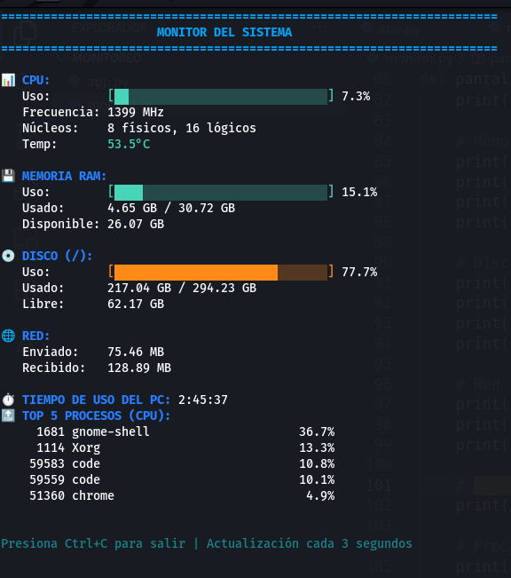

# 🖥️ sysmon

> Monitor simple y claro del sistema para Linux. Sin ruido, solo la información que necesitas.

[](https://opensource.org/licenses/MIT)
[](https://www.python.org/downloads/)



## 🎯 ¿Por qué sysmon?

Cansado de herramientas complejas con demasiada información? **sysmon** te muestra solo lo esencial de forma clara y visual.

- ✨ Sin parpadeos molestos
- 🎨 Colores intuitivos (verde ➜ amarillo ➜ rojo)
- 📊 Barras de progreso visuales
- ⚡ Actualización en tiempo real
- 🚀 Ligero y rápido

## ✨ Características

| Característica | Descripción |
|---------------|-------------|
| 📊 **CPU** | Uso, frecuencia, núcleos, temperatura, historial y carga media |
| 💾 **RAM** | Memoria usada, disponible y porcentaje |
| 💾 **Swap** | Uso de memoria de intercambio |
| 💿 **Discos** | Todas las particiones montadas (hasta 4) |
| 🌐 **Red** | Velocidad de subida/bajada en tiempo real y totales |
| 🔌 **IPs** | IP local por interfaz e IP pública (opcional) |
| ⏱️ **Uptime** | Tiempo encendido y número de procesos |
| 🔝 **Procesos** | Tabla adaptable al alto de la terminal, ordenable por CPU o MEM |

## 🚀 Instalación

### Método 1: Instalación automática (Recomendado)

```bash
# Clonar el repositorio
git clone https://github.com/syruxst/sysmon.git
cd sysmon

# Ejecutar el instalador
chmod +x install.sh
sudo ./install.sh
```

### Método 2: Instalación manual

```bash
# Instalar psutil desde los repositorios de tu distribución
sudo apt install python3-psutil

# Copiar a /usr/local/bin
sudo install -m 0755 -o root -g root sysmon.py /usr/local/bin/sysmon
```

### Método 3: Uso sin instalar

```bash
# Instalar solo las dependencias
sudo apt install python3-psutil

# Ejecutar directamente
python3 sysmon.py
```

## 💻 Uso

Una vez instalado, simplemente ejecuta:

```bash
sysmon
```

### Teclas

| Tecla | Acción |
|-------|--------|
| `q` / `Ctrl+C` | Salir |
| `s` | Ordenar procesos por CPU o por memoria |

### Opciones

```bash
sysmon -i 1           # actualizar cada 1 segundo (0.5 - 60, por defecto 2)
sysmon --public-ip    # mostrar también la IP pública (consulta api.ipify.org cada 5 min)
sysmon --once         # imprimir una sola instantánea y salir (útil en scripts)
sysmon --no-color     # sin colores (también respeta la variable NO_COLOR)
```

## 📋 Requisitos

- **Sistema Operativo:** Linux (cualquier distribución)
- **Python:** 3.6 o superior
- **Dependencias:** psutil (el instalador lo instala desde el gestor de paquetes del sistema)

### Distribuciones probadas:
- ✅ Ubuntu / Debian
- ✅ Fedora / RHEL
- ✅ Arch Linux
- ✅ Linux Mint
- ✅ Pop!_OS

## 🎨 Personalización

### Cambiar la frecuencia de actualización

Usa la opción `-i`, sin editar el código:

```bash
sysmon -i 5   # menos uso de CPU
```

## 📊 Indicadores de color

Los colores te ayudan a identificar el estado del sistema de un vistazo:

- 🟢 **Verde:** Todo bien (< 50%)
- 🟡 **Amarillo:** Uso moderado (50-80%)
- 🔴 **Rojo:** Uso alto (> 80%)

## 🗑️ Desinstalación

```bash
sudo ./install.sh --uninstall
```

## 🔒 Seguridad

- Los nombres de procesos, usuarios, interfaces y puntos de montaje se **sanean** antes de mostrarse: un proceso con secuencias de escape en su nombre no puede manipular tu terminal.
- **No se hace ninguna conexión externa** por defecto. La IP pública solo se consulta con `--public-ip` (por HTTPS con certificado verificado) y solo se muestra si la respuesta es una IP válida.
- La terminal se restaura siempre al salir, incluso con `SIGTERM` o `SIGHUP`.
- El instalador no usa `pip` como root: instala `psutil` desde los paquetes firmados de tu distribución, instala el binario como `root:root 0755` de forma atómica y fija el intérprete con `python3 -I` (modo aislado) para que `PYTHONPATH` o archivos del directorio actual no puedan inyectar código.

## 🐛 Solución de problemas

### "psutil no está instalado"
```bash
sudo apt install python3-psutil      # Debian / Ubuntu / Kali
sudo dnf install python3-psutil      # Fedora / RHEL
sudo pacman -S python-psutil         # Arch
```

### "Permiso denegado"
Asegúrate de ejecutar el instalador con `sudo`:
```bash
sudo ./install.sh
```

### "No se muestra la temperatura"
Algunos sistemas no exponen la temperatura del CPU. Esto es normal y no afecta el funcionamiento.

## 🤝 Contribuir

Las contribuciones son bienvenidas! Puedes:

1. 🐛 Reportar bugs
2. 💡 Sugerir nuevas características
3. 🔧 Enviar pull requests
4. 📖 Mejorar la documentación

### Cómo contribuir:

```bash
# Fork el proyecto
git clone https://github.com/syruxst/sysmon.git
cd sysmon

# Crear una rama
git checkout -b mi-nueva-funcionalidad

# Hacer cambios y commit
git commit -am 'Añadir nueva funcionalidad'

# Push a la rama
git push origin mi-nueva-funcionalidad

# Crear Pull Request en GitHub
```

## 📝 Changelog

### v2.0.0
- 🎨 Nueva interfaz con paneles, pantalla alternativa y diseño adaptable al tamaño de la terminal
- 📈 Historial de CPU, uso por núcleo, swap, múltiples discos y velocidad de red
- ⌨️ Teclas `q` y `s`, opciones `-i`, `--once`, `--no-color`, `--public-ip`
- 🔒 Saneado de texto contra inyección de secuencias de escape
- 🔒 IP pública opcional y validada; se elimina la dependencia de `requests`
- 🔒 Instalador endurecido (sin pip como root, instalación atómica, `--uninstall`)

### v1.0.0 (2025-10-15)
- 🎉 Lanzamiento inicial
- ✨ Monitor básico con CPU, RAM, Disco, Red
- 📊 Barras de progreso visuales
- 🎨 Sistema de colores intuitivo
- ⚡ Actualización sin parpadeos

## 📄 Licencia

Este proyecto está bajo la Licencia MIT. Ver el archivo [LICENSE](LICENSE) para más detalles.

## 🙏 Agradecimientos

- Inspirado en `htop`, `top`, y `glances`
- Construido con [psutil](https://github.com/giampaolo/psutil)
- Gracias a todos los contribuidores

## 👨‍💻 Autor

Creado con ❤️ por Daniel Ugalde

---

<div align="center">

**¿Te gusta sysmon?** Dale una ⭐ en GitHub!

[Reportar Bug](https://github.com/syruxst/sysmon/issues) · [Solicitar Feature](https://github.com/syruxst/sysmon/issues) · [Documentación](https://github.com/syruxst/sysmon/wiki)

</div># sysmon
